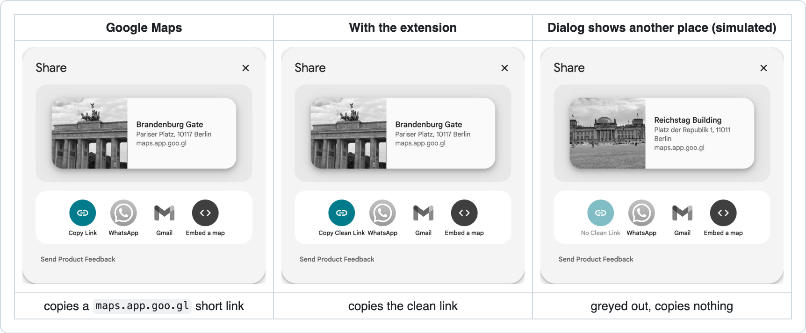
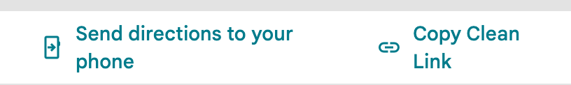

# Clean Share Link for Google Maps

Copy Google Maps links without tracking. This free, open-source browser extension changes Google’s **Copy Link** button into **Copy Clean Link**. Instead of a unique `maps.app.goo.gl` short link for each share, you get a direct Google Maps link with place ID and coordinates. It uses the link format that Google documents as [Maps URLs](https://developers.google.com/maps/documentation/urls/get-started).



The relevant copy button is highlighted in colour. The third dialog shows a different place (Reichstag) from the one in the address bar (Brandenburg Gate, not in the picture). There is no clean link for this case, so the button is greyed out and shows *No Clean Link*.

The directions panel gets the corresponding button:



## Examples

```
https://www.google.com/maps/search/?api=1&query=52.5162746,13.3777041&query_place_id=ChIJiQnyVcZRqEcRY0xnhE77uyY
```

This is the Brandenburg Gate in Berlin. More examples: the [Reichstag](https://www.google.com/maps/search/?api=1&query=52.5186202,13.3761872&query_place_id=ChIJbVDuQcdRqEcR5X3xq9NSG2Q) and a [walking route from the Brandenburg Gate to the Reichstag](https://www.google.com/maps/dir/?api=1&origin=Brandenburger%20Tor%2C%20Pariser%20Platz%2C%2010117%20Berlin&origin_place_id=ChIJiQnyVcZRqEcRY0xnhE77uyY&destination=Reichstagsgeb%C3%A4ude%2C%20Platz%20der%20Republik%201%2C%2011011%20Berlin&destination_place_id=ChIJbVDuQcdRqEcR5X3xq9NSG2Q&travelmode=walking).

## Why

Each time you share a place, Google creates a new `maps.app.goo.gl` short link. Whoever opens it is sent through Google’s server, which adds a code that is different for every share. So Google can see which share a visit came from. There does not seem to be any official documentation for this (see [details](docs/details.md#why)). The clean link opens the place directly by its place ID. If that does not work, it uses the coordinates.

## What it does

- Works for places, dropped pins, searches, routes, Street View and map views, on [all Google domains](https://www.google.com/supported_domains).
- Only the button copies the clean link. The upper part of the share dialog (picture, name, address, short link) still belongs to Google and copies Google’s short link.
- If the dialog shows a different place from the one in the address bar, the button shows *No Clean Link*, is greyed out and copies nothing.
- In Firefox for Android, the system share menu receives the clean link.
- Saved lists and other pages keep Google’s button.
- No API key, no account, no settings, no toolbar button, no network requests and no data collection (see [PRIVACY.md](PRIVACY.md)).

## Install

The extension is not in any store yet. For Chrome, Edge and Brave, and for loading it in Firefox on a computer until Firefox closes, you need only step 1. All other ways need steps 1 to 3. For the userscript, run `npm run build:userscript` instead of the two commands in step 3 (see the last row).

1. Download this project: on GitHub, click **Code**, then **Download ZIP**, and unpack it. In this guide, *the project folder* is the folder that contains `manifest.json` and `package.json`. On Windows, *Extract All* often puts a second folder with the same name inside the new folder; the project folder is the inner one.
2. Install [Node.js](https://nodejs.org/) 18 or newer.
3. Open a terminal: Terminal on macOS and Linux, Command Prompt on Windows (search for `cmd` in the Start menu). Type `cd ` with a space (on Windows `cd /d `), add the path of the project folder and press Enter. On macOS you can [drag the project folder into the Terminal window](https://support.apple.com/guide/terminal/drag-items-into-a-terminal-window-trml106/mac) to add its path. On Windows, open the project folder in File Explorer, click its address bar, copy the path and paste it into Command Prompt with Ctrl+V. Then run these two commands, one after the other:

```
npm install
npm run build
```

`npm install` downloads Mozilla’s build tool [web-ext](https://github.com/mozilla/web-ext) into the folder `node_modules`. `npm run build` creates the zip file in the folder `dist`. The zip contains only the files that the extension needs; tests, documentation and scripts stay out.

| Browser | How |
| --- | --- |
| Firefox ESR, Developer Edition, Nightly | Open `about:config` and set `xpinstall.signatures.required` to `false` (this applies to all add-ons in this Firefox profile). Then open `about:addons` → gear icon → **Install Add-on From File…** → choose the zip. |
| Firefox for Android (Nightly) | Copy the zip to the phone and set the same setting in `about:config` on the phone. Then *Settings → About Firefox Nightly*, tap the logo five times, then *Settings → Install extension from file* → choose the zip. |
| Firefox (release and Beta) | Use the userscript (last row; not tested on Android), or, on a computer, load the extension until Firefox closes: `about:debugging` → **This Firefox** → **Load Temporary Add-on…** → `manifest.json` in the project folder. |
| Chrome, Edge, Brave | `chrome://extensions` → *Developer mode* → **Load unpacked** → choose the project folder. |
| Safari on macOS | *Settings → Advanced → Show features for web developers*. Then *Settings → Developer → Add Temporary Extension…* → choose the zip, and allow it on your Google domain. Safari removes it after 24 hours or when you quit Safari. In Safari 27.2 this works only in a macOS user account with a login password. |
| Safari on iPhone and iPad | As a userscript, for example with the free Userscripts app (last row); not tested. The extension itself would need its own app, which this project does not provide. |
| Userscript: any browser with a userscript manager such as Violentmonkey, and Safari on iPhone and iPad with the Userscripts app | Run `npm run build:userscript`. Then install the file `dist/clean-share-link-for-google-maps.user.js` in the manager. The [step-by-step guide](docs/details.md#userscript-with-violentmonkey) shows the tested way: a small web server on your own computer, which needs Python. On iPhone and iPad, save the file into the Userscripts folder in the Files app ([steps](docs/details.md#safari-on-iphone-and-ipad)). |

All steps in detail, with sources: [docs/details.md](docs/details.md).

## Recently tested

Firefox, Firefox for Android (with an earlier version of the extension), Brave (Chromium) and Safari on macOS, also as a userscript with Violentmonkey in Firefox. Not tested on iPhone and iPad. See [details](docs/details.md#testing).

## Development

```
npm install               # downloads web-ext (needs Node.js 18 or newer)
npm test                  # unit tests
npm run lint              # checks the extension with Mozilla’s add-on linter
npm run build             # zip for installing from file and for the stores
npm run build:userscript  # userscript and .meta.js in dist/
npm run check-domains     # compares the manifest’s domains with Google’s list
```

## License

MIT, see `LICENSE`. The link glyph in `icon.svg` is the `link` symbol from Google’s [Material Symbols](https://github.com/google/material-design-icons) (rounded, weight 700), licensed under the [Apache License 2.0](https://github.com/google/material-design-icons/blob/master/LICENSE).

Assisted-by: Claude Opus 5.5 (xhigh) for development, review and the userscript build, Claude Fable 5.1 (xhigh) for review and new features.

Google Maps is a trademark of Google LLC. This project has no connection to Google and is not endorsed by Google. The screenshots show the Google Maps website, partly changed by this extension and [edited for this page](docs/details.md#screenshots). Other marks shown, such as WhatsApp and Gmail, belong to their owners.
